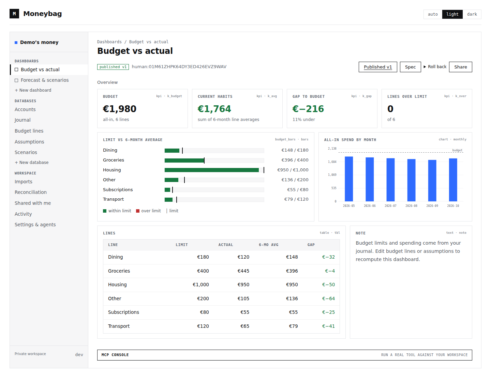

# Moneybag

[](https://github.com/olegpustovit/moneybag/actions/workflows/check.yml)

An invite-only finance engine for people and MCP agents. A Go binary serves the ledger, imports, budgets, forecasts, dashboards, OAuth and the web UI.



The screenshot is from the running application. Every amount, account and transaction shown is synthetic. [Dark theme](docs/screenshots/dashboard-dark.png) · [Mobile](docs/screenshots/dashboard-mobile.png)

- Explicit cost lots, cost basis and unrealized profit/loss using historical quotes; ECB FX refresh and manual metal/security quotes.
- Exact Decimal128 amounts and balanced postings for every commodity. Posted entries are immutable; corrections append reversals. Drafts can be posted later.
- Staged PrivatBank XLSX, Wise CSV, mapped CSV and Plaid JSON imports, with provenance, duplicate detection, resumable commits and undo.
- Expense rules, tags, balance assertions, reconciliation and monthly budgets.
- Typed spreadsheet tables, CEL formulas, income streams, scenario overlays and forecasts.
- Versioned dashboards rendered as HTML/SVG, private HTML/PNG previews, publish validation, rollback and restricted dashboard sharing. KPI components can set `sparkline` to a CEL expression returning up to 600 finite numbers, for example `[1.0, 2.0, 1.5]`.
- 64 typed MCP tools, eight resource definitions and five prompts. OAuth code + S256 PKCE, rotating refresh tokens and separate full/read-only endpoints.

**One shared `moneybag` database serves all users.** Financial records, queries, indexes and counters are scoped by `user_id`. Production reuses the existing standalone MongoDB on oracle-vm at `127.0.0.1:27017`. The API listens on `127.0.0.1:6459`; Caddy is configured separately.

## Run

Go 1.26.10 and MongoDB are required. No frontend build is needed.

```sh
cd backend
go build -o bin/moneybag ./cmd/api
export MONEYBAG_SETUP_TOKEN="$(openssl rand -hex 32)"
printf 'Setup token: %s\n' "$MONEYBAG_SETUP_TOKEN"
MONEYBAG_PUBLIC_URL=http://127.0.0.1:6459 ./bin/moneybag
```

Save the setup token privately before starting, then visit `/setup` to create the owner. Further users need invitations. Set `MONEYBAG_SECRET_KEY` to a stable base64-encoded 32-byte key before connecting feeds. PNG rendering needs `MONEYBAG_CHROMIUM_BIN` pointing to a working Chromium executable.

[Configuration](docs/configuration.md) · [Deployment and operations](docs/operations.md) · [Architecture and data model](docs/architecture.md) · [Design system](DESIGN.md)

## Connect an agent

Use `https://moneybag.microapps.space/mcp`, or `/mcp/readonly` for a catalog containing read tools only. Authorize through the browser with the scopes the agent needs. Revoke connections in Settings. The endpoint advertises its OAuth metadata when called without a bearer token.

The browser MCP console uses the same services as remote agents. Start with `whoami`, `accounts_list`, `db_list` and `model_get`. Import real data through the staged import workflow; the engine does not fabricate historical transactions.

For a local stdio client:

```sh
cd backend
go build -o bin/moneybag-mcp ./cmd/mcp
MONEYBAG_MCP_TOKEN_FILE=/private/path/access-token ./bin/moneybag-mcp
```

The token file must be private (`0600`) and contain a valid OAuth access token. The adapter rereads it on each request so a token manager can rotate it. `MONEYBAG_MCP_URL` selects the full or read-only endpoint. Stdio forwards to the API, keeping one writer process.

## Verify

```sh
cd backend
go test ./...
go vet ./...
MONEYBAG_TEST_MONGO_URI=mongodb://127.0.0.1:27017/moneybag_test_local go test ./integration -v
```

The integration suite requires a disposable database whose name starts with `moneybag_test_`; it drops that database. It checks colliding user IDs in shared collections, ledger invariants, OAuth, import retries, rules, reconciliation, sharing, undo/redo and all 64 tool scope guards through the official MCP SDK. Integration tests skip when the environment variable is absent.

Browser checks use a separate synthetic QA environment on port 6460. Start the QA server with `MONEYBAG_SETUP_TOKEN=synthetic-preview-token`, a disposable MongoDB database, and `MONEYBAG_CHROMIUM_BIN` set for `dashboard_render`:

```sh
cd e2e
npm ci
npx playwright install chromium
npm test
```

They exercise real pages, persistent cell edits, statement imports, desktop/mobile themes and private HTML/PNG previews. The original eight forecast scenarios also have a private, opt-in parity fixture excluded from this repository.

## Write model

Standalone MongoDB provides atomic document writes. Moneybag serializes financial workflows in one API process and records an audit intent before each mutation and its outcome afterward. Interrupted multi-document work remains detectable; imports use stable IDs to resume. Inspect audit history before retrying ambiguous writes. Coordinate writers before running multiple API replicas.
