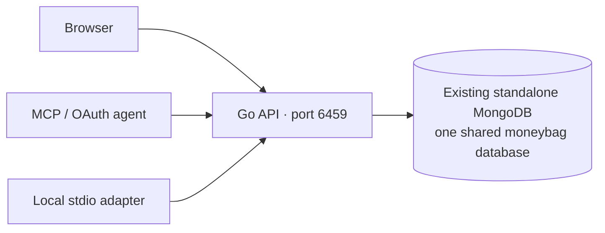

# Architecture and data model

The Fiber transport and browser handlers live in `backend/cmd/api`. Domain services and Mongo repositories belong to `internal/components`. Both HTTP MCP transports use `internal/mcpserver`; `cmd/mcp` forwards stdio to the same API through the official SDK.

Every financial collection includes `user_id`. Logical IDs such as `assets:bank`, `assumptions` or `base` may collide between users. Their physical key or unique index includes the owner. Journal and audit sequences come from per-user atomic counters. There are no per-user databases or collection names.

| Collection group | Ownership and behavior |
|---|---|
| `users`, sessions, invites, OAuth | Global identity keys; sessions and bearer credentials resolve the principal before financial access |
| `accounts`, `journal`, `entry_tags` | Scoped accounts; exact per-commodity balanced journal documents; posted journal immutable; tags stored as metadata |
| `events`, `audit_outcomes`, `counters` | Per-user hash chain and durable intent/outcome records; missing outcomes identify interrupted writes |
| `import_batches`, `import_rows`, raw files, `feeds` | User-scoped provenance, account + dedupe-key unique index, stable journal IDs and encrypted credentials |
| `balance_assertions`, `discrepancies`, `budgets`, `rules` | Scoped reconciliation, classification and monthly reporting |
| `prices`, `tables`, `rows`, `scenarios`, `income_models` | Historical valuation, typed cells/formulas, scenario overrides and income streams |
| `dashboards`, `dashboard_versions` | Scoped head pointers and immutable versions; publish validates and renders before changing the head |
| `shares`, `dashboard_snapshots` | Explicit `owner_user` / `grantee_user`; the only cross-user financial data path |

Sharing fixes the owner principal and permits only the declared source set and optional CEL row filter. Viewers receive rendered output. Editors use the share ID through dashboard tools and cannot reshare or add sources beyond the grant. Grants support expiry and revocation.

CEL has no network or filesystem access. Expressions are compiled and cached with length, recursion, cost, row, byte and wall-time limits. The same escaped HTML/SVG renderer serves the web UI and previews. Preview URLs require the authenticated requesting user and expire after ten minutes. Chromium reads a private local HTML file with scripts and network resources blocked.

Money is encoded as decimal strings in public JSON and Decimal128 in MongoDB. Journal balance validation uses exact rational arithmetic. Valuation and forecast outputs are reporting values; forecasts never post journal entries.

`balances_get` with `include_lots: true` returns asset positions grouped by account, commodity and explicit per-unit `cost`. Set the same cost on acquisitions, disposals, transfers and corrections to select the lot. Missing costs remain unknown rather than being inferred. With `value_in`, each lot includes historical market value, known cost basis and unrealized profit/loss. Reports are bounded to 10,000 entries, 5,000 lots and 16 MiB; narrow by accounts for larger histories.
